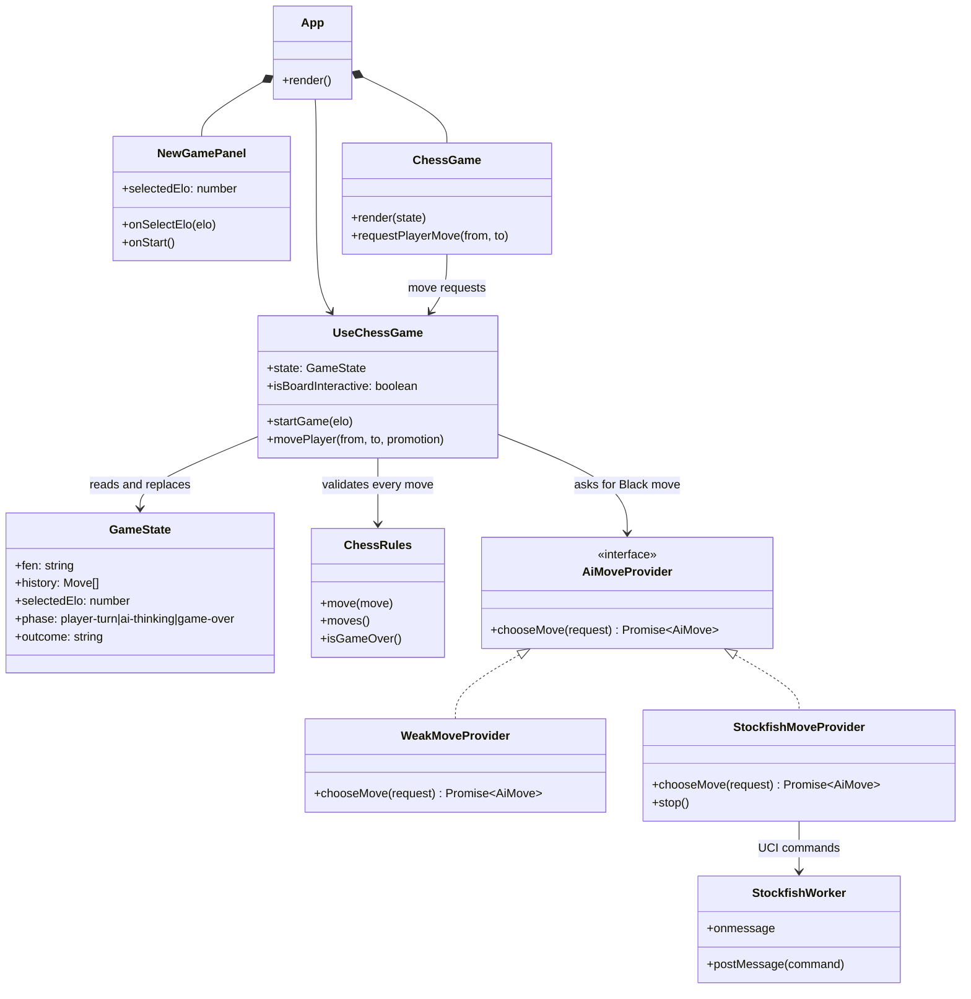
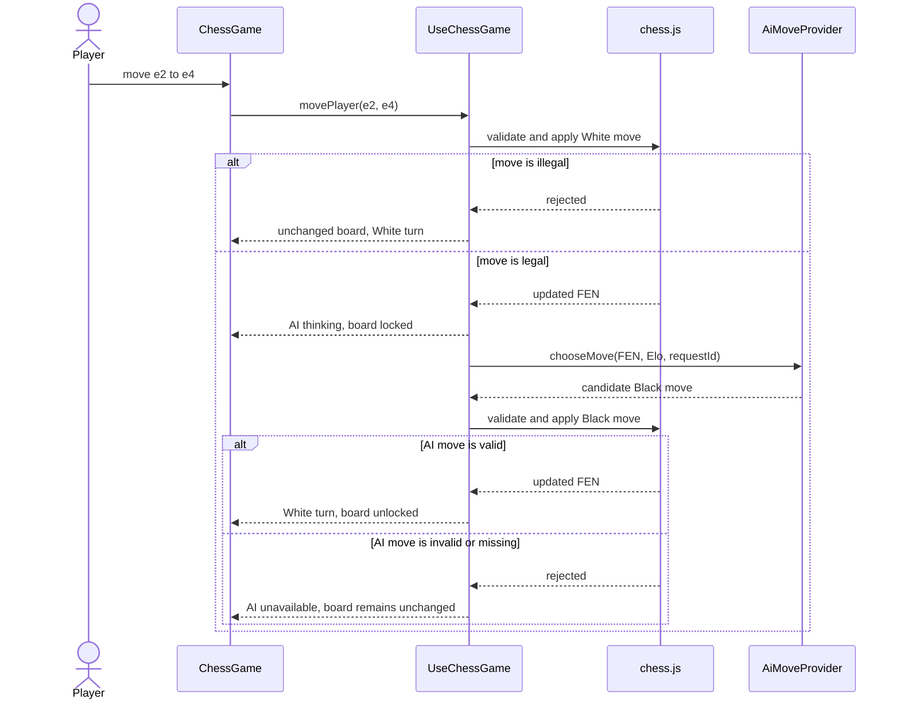
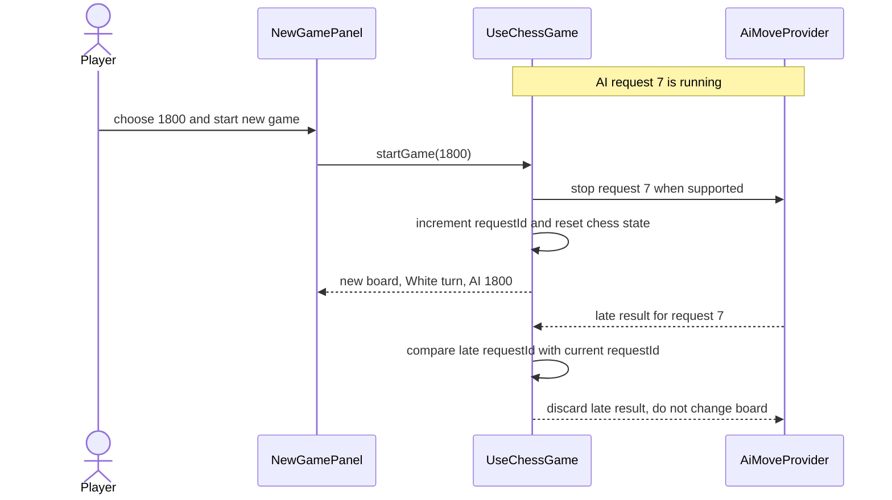

# Chess AI Game — Approved BDD Specification

## Product outcome

Players practise standard chess in a browser against a local AI labelled with one of 21 **Estimated Elo** strengths: 200, 300, …, 2200. The labels are product estimates, not Chess.org ratings and not a guarantee of a human Elo equivalence.

## Scope

- A player starts a standard chess game as either White or Black.
- The player chooses an Estimated Elo strength before a new game.
- Legal player moves are followed by one legal AI Black move.
- Illegal moves leave position and turn unchanged.
- Player input is disabled while the AI is choosing a move.
- The first implementation increment proves the 200-strength full turn; the delivered application expands to all approved strengths and standard game-over states.

## Approved acceptance scenarios

```gherkin
Feature: Play a first move against an AI opponent
  To practise chess at an appropriate challenge level
  As a player
  I want to start a game against an AI with an estimated Elo strength

  Rule: Players choose from supported estimated Elo strengths
    Scenario: Available strengths are shown in 100-point increments
      Given the player is on the new-game screen
      When the player opens the AI strength selector
      Then the available strengths are 200 through 2200 in increments of 100
      And the screen identifies them as estimated Elo strengths
      And the screen does not describe them as Chess.org ratings

  Rule: A new game starts with the selected strength and standard chess setup
    Scenario: Player starts a 200-strength game
      Given the player selected estimated Elo 200
      When the player starts a new game
      Then a standard chess position is shown
      And the player controls White
      And it is White's turn
      And the opponent is labelled "AI · Estimated Elo 200"

  Rule: A legal player move is followed by a legal AI move
    Scenario: Player opens with a legal pawn move
      Given a new estimated Elo 200 game is in progress
      And it is White's turn
      When the player moves the pawn from e2 to e4
      Then the board shows the pawn on e4
      And the AI makes one legal move for Black
      And it becomes White's turn

  Rule: An illegal move does not change game state
    Scenario: Player attempts an illegal pawn move
      Given a new estimated Elo 200 game is in progress
      And it is White's turn
      When the player attempts to move the pawn from e2 to e5
      Then the board position is unchanged
      And the AI does not make a move
      And it remains White's turn

  Rule: Players cannot move during the AI turn
    Scenario: Player attempts to move while the AI is thinking
      Given a new estimated Elo 200 game is in progress
      And the player has made a legal White move
      And the AI is choosing its Black move
      When the player attempts another White move
      Then the board position is unchanged
      And the game remains in the AI turn
```

## Approved extension: player colour and PGN review

```gherkin
Feature: Review and export a game played from either side
  To learn from completed or saved games
  As a chess player
  I want to choose my colour and review portable game records one move at a time

  Rule: The player's selected colour controls board orientation and whose turn accepts input
    Scenario: Player starts a game as Black
      Given the player selected Black and an estimated Elo strength
      When the player starts a new game
      Then the board is oriented for Black
      And the AI makes one legal White move
      And the player may make a legal Black move when the AI turn ends

  Rule: A live game record is shown in move order
    Scenario: Player sees the moves after a completed turn
      Given a game contains one White move and one Black move
      When the player views the game record
      Then the record shows both moves in chronological order
      And the latest move is identified as the current position

  Rule: A live game can be exported as a portable PGN record
    Scenario: Player downloads a game record
      Given a game contains legal moves
      When the player downloads the record
      Then a PGN file containing those moves is downloaded
      And the PGN contains the basic game header information

  Rule: An imported PGN is a read-only review
    Scenario: Player imports a valid PGN
      Given the player has a valid PGN game record
      When the player uploads the record
      Then the board shows the initial position of that record
      And the moves are shown in chronological order
      And the game is in review mode
      And the player cannot make a chess move

  Rule: A reviewer can move one recorded position at a time
    Scenario: Player steps forward and backward through an imported game
      Given an imported game contains at least two moves
      And the review starts at the initial position
      When the player advances one move
      Then the board shows the position after the first move
      And the first move is identified as current
      When the player returns one move
      Then the board shows the initial position

  Rule: A finished live game can be reviewed without exporting and importing it
    Scenario: Player reviews the game that just ended
      Given a live game has reached a standard game-over state
      When the player views the game record
      Then first, previous, next, and last position controls are available
      And the player can move from the final position to an earlier recorded position
      And the board is read-only while an earlier position is displayed

  Rule: An active game cannot be rewound
    Scenario: Player views a game that has not ended
      Given a live game is still in progress
      When the player views the game record
      Then no position-navigation controls are available
      And the board remains at the current live position

  Rule: Invalid imports do not replace the current game or review
    Scenario: Player uploads an invalid game record
      Given the player has a game or review open
      When the player uploads an invalid PGN file
      Then the open game or review remains unchanged
      And the player sees an understandable import error
```

## Technical decisions

- React and TypeScript render the local browser UI.
- `chess.js` is the authoritative legal-rules engine. No UI or AI move is trusted without validation by a `Chess` instance.
- The game controller owns FEN, history, turn/phase, configured strength, and AI request identity.
- AI executes behind an `AiMoveProvider` interface. A deterministic weak provider supports the first vertical slice; a Web Worker-backed Stockfish provider is used for engine-backed strengths.
- Stockfish's current UCI Elo floor is 1320. Strengths 200–1200 therefore use a calibrated fallible-move selector; 1300–2200 use `UCI_LimitStrength` + `UCI_Elo`. The visible 1300 product level maps to Stockfish 1320 internally; the label remains an estimate, not an engine or Chess.org rating.
- The application is local-only: no account, external AI API, rating service, multiplayer, persistent saved games, or timer. PGN files are explicitly imported and exported by the player.
- Any Stockfish distribution must include the required GPL-3.0 notices and complete corresponding-source offer/material appropriate to the chosen distribution method before publication.

## Logic diagrams

### Class and responsibility diagram



Plain meaning: the UI never decides whether a move is legal. `UseChessGame` asks `ChessRules` first; it is also the only layer allowed to apply an AI move. The AI provider can be replaced without changing chess rules or screen components.

### Main turn sequence



Plain meaning: a legal White move is the only event that starts AI thinking. A failed player move cannot cause an AI reply. A failed AI move never corrupts the chess position.

### Restart and stale-AI-response sequence



Plain meaning: restarting a game always wins over a slow AI response. The request ID prevents an old move from being played in the new game.

## Non-goals for this plan

- Timers, hints, analysis bar, persistent saved games, online play, user accounts, leaderboard, or branded Chess.org/Chess.com integration.
