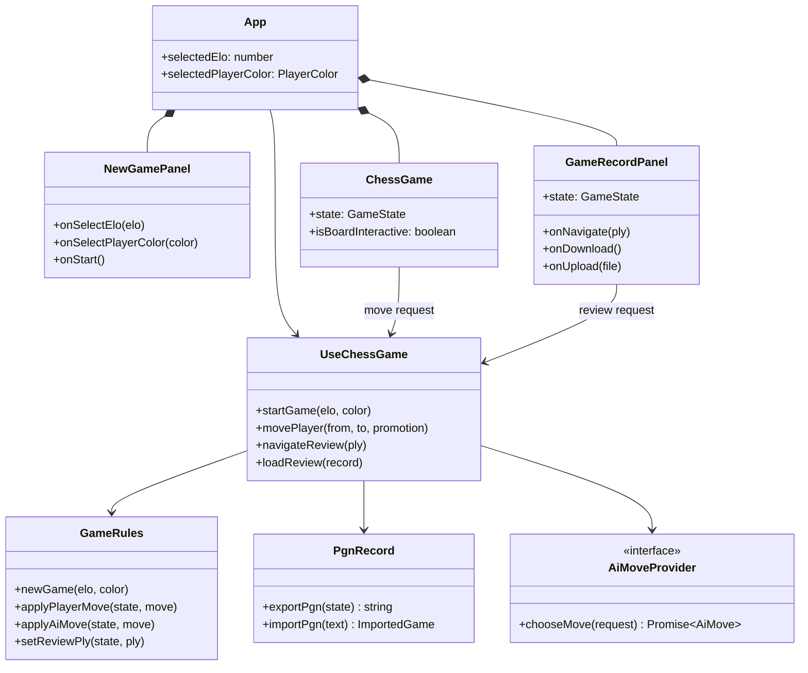
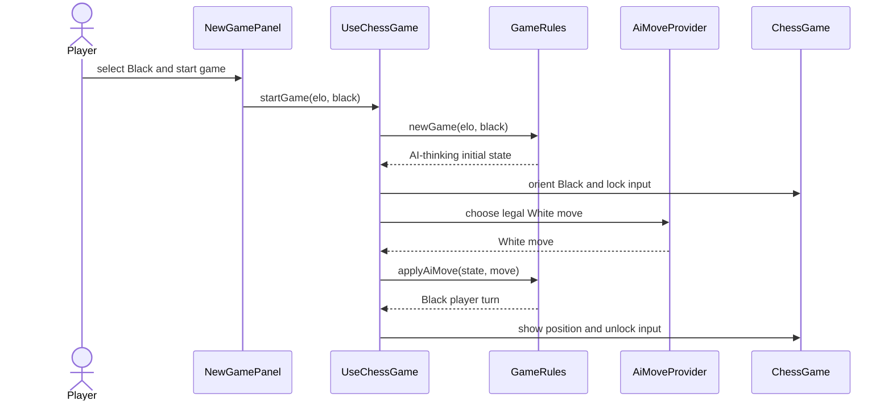
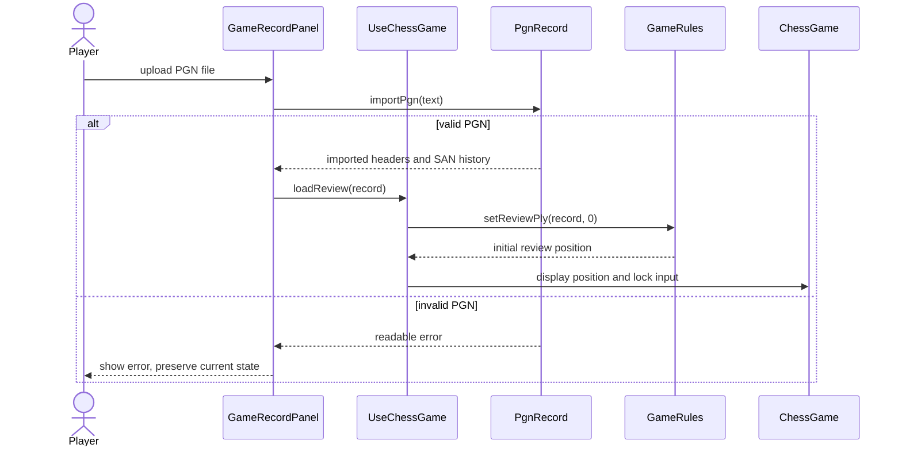

# PGN Review and Player Colour Design

## Goal

Let a player choose White or Black for a new local AI game, see the full move record beside the board, export it as PGN, and import a PGN as a read-only step-by-step review.

## Scope and constraints

- Support player colours `white` and `black` in new games.
- Use portable PGN for download and upload.
- Imported PGN is review-only; it can never resume a game against the AI.
- Use `chess.js` as the authority for legal moves, PGN validation, and position reconstruction.
- Keep games local in the browser. There is no account, cloud storage, sharing, or persistent saved-game feature.
- Do not add a Git commit as part of this work.

## State model

`GameState` represents both a live game and a review. It records the player colour, the starting position, headers, SAN move history, and the ply currently shown.

```ts
type PlayerColor = 'white' | 'black'
type GameMode = 'play' | 'review'

interface GameState {
  fen: string
  history: string[]
  selectedElo: number
  playerColor: PlayerColor
  mode: GameMode
  viewPly: number
  initialFen: string
  headers: Record<string, string>
  phase: 'player-turn' | 'ai-thinking' | 'game-over'
  outcome: string | null
}
```

`viewPly` is zero for the initial position and increments once for every half-move. In `play` mode it equals `history.length`; in `review` mode it can range from zero through `history.length`.

The current FEN is never trusted from an upload. The PGN is loaded and replayed through `chess.js`; navigating a review reconstructs the FEN from `initialFen` and the SAN prefix up to `viewPly`.

## Component boundaries



`GameRecordPanel` is presentation and browser-file handling only. `PgnRecord` is a pure domain boundary, so importing and exporting can be tested without a browser download dialog.

## Live-game behaviour

When the user selects White, White moves first. When the user selects Black, the controller immediately requests the first AI move and the board is oriented for Black.



Player input is enabled only when `phase` is `player-turn`, `mode` is `play`, and the side to move matches `playerColor`. Every AI move continues to be validated by `GameRules`.

## PGN import, export, and review behaviour

Live records export a portable PGN with standard header fields and current SAN history. Importing is atomic: parse into a temporary `chess.js` instance first, then replace the UI state only on success. An error never erases a live game or existing review.



Navigation accepts only `0 <= ply <= history.length`. The UI provides first, previous, next, and last controls for imported reviews and for a live game after it reaches `game-over`; an active live game has no navigation controls. The displayed move list highlights the SAN entry at `viewPly - 1`; no move is highlighted at the initial position.

## File and UI changes

| File | Responsibility |
|---|---|
| `src/domain/game.ts` | Player colour, live/review state transitions, position reconstruction. |
| `src/domain/pgn.ts` | Parse and export portable PGN without DOM dependencies. |
| `src/hooks/useChessGame.ts` | Start an AI-first Black game, cancel stale requests, load and navigate reviews. |
| `src/components/NewGamePanel.tsx` | White/Black selector. |
| `src/components/ChessGame.tsx` | Dynamic orientation and review-mode input lock. |
| `src/components/GameRecordPanel.tsx` | Record list, review navigation, PGN upload/download controls and errors. |
| `src/App.tsx` | Compose the new panel and bridge browser file APIs to the controller. |
| `src/styles.css` | Three-column desktop layout and responsive record panel. |

## Automation strategy

| Approved rule | Level | Evidence |
|---|---|---|
| Colour controls legal player and AI turns | Domain and hook | Black starts in AI-thinking state; legal AI White move unlocks Black input. |
| Game history and review navigation reconstruct positions | Domain | FEN at ply zero, one, and final ply matches replayed SAN history. |
| PGN export/import is portable and safe | Domain | Exported record reloads; invalid text throws a readable error without state replacement. |
| Record UI presents current move and locks review | Component | Current move is marked and board receives non-interactive state. |
| High-value user journeys are connected | Playwright | Select Black and receive AI opening; import then navigate a PGN review. |

## Non-goals

- Resuming imported games against the AI.
- Editing, annotating, or deleting individual moves.
- Cloud storage, accounts, sharing links, automatic local persistence, timers, hints, or analysis.

## Risks and mitigations

- **Late AI result after reset/import:** increment the existing request ID and call `stop()` where available before replacing state.
- **Invalid or unsupported PGN:** parse before state replacement and show a user-facing error.
- **Complex PGN setup positions:** preserve the imported `SetUp`/`FEN` starting position when provided; standard games start from normal chess setup.
- **Small screens:** stack the record panel under the board instead of squeezing three columns.
